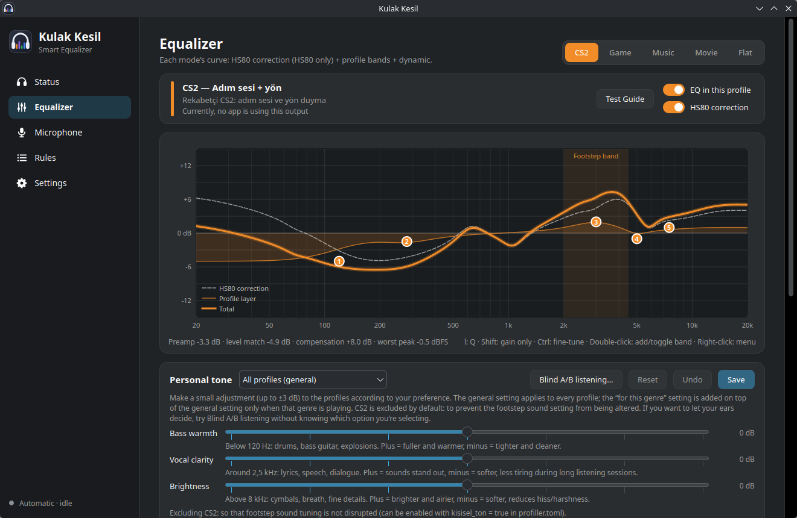
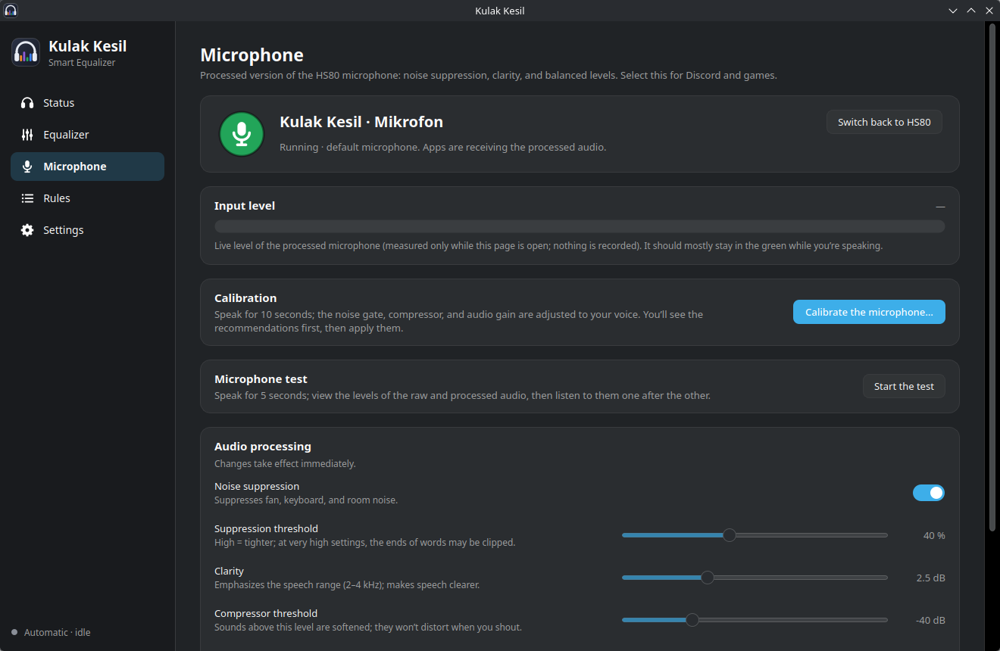

# Kulak Kesil — per-app automatic EQ for PipeWire

*Türkçe: [README.tr.md](README.tr.md)*

**Kulak Kesil** ("be all ears" in Turkish) gives **every app its own equalizer,
chosen automatically**. Your game, your music and your movie each get the sound
that suits them, at the same time, with no manual switching. Voice chat and system
sounds stay untouched.

Playing CS2 with Spotify in the background and a friend on Discord? CS2 gets the
footstep profile, Spotify gets the music profile and Discord stays flat, all at once.

<p align="center">
  
  
</p>

| Profile | Tuned for | Used for |
|---|---|---|
| 🎯 **CS2** | footsteps and quiet cues forward, harsh gun/flash transients tamed | Counter-Strike 2 |
| 🎮 **Game** | atmosphere, depth | other games (Steam, Proton, Lutris, Faugus, Wine) |
| 🎵 **Music** | natural timbre | music players, music in the browser |
| 🎬 **Movie** | clear dialogue, night mode | video players, series/films in the browser |
| ➖ **Flat** | no EQ, loudness-matched | Discord, TeamSpeak, calls, notifications, system sounds |

## Features

- **Per-stream routing.** Each audio stream is identified (process, Proton `.exe`,
  MPRIS player, browser site) and moved to its own virtual EQ output.
- **Genre sub-profiles.** Music and games get an extra genre layer (Metal/Rock,
  Electronic/Hip-hop, Classical/Jazz/Acoustic, Pop/Vocal, Podcast · Competitive/FPS,
  Horror, Action/RPG, Strategy, Racing). It switches only when the song or game
  changes, smoothly, never mid-song.
- **Knows what's playing in the browser.** Site and player metadata first. When that's
  missing, a few seconds of local listening tell music from speech.
- **Loudness-matched.** Switching profiles doesn't make things suddenly louder or quieter.
- **Voice ducking.** When someone talks on Discord, game/music/movie dip by 6 dB, then
  come back.
- **Processed microphone.** A virtual mic with RNNoise noise suppression, clarity and
  a compressor. Includes a raw-vs-processed test and auto-calibration.
- **Headphones only.** EQ turns on for USB, Bluetooth and 3.5 mm headphones. When you
  switch to speakers or HDMI, nothing is processed.
- **Your taste on top.** A personal 3-band tone (bass / vocals / brightness), plus a blind
  A/B test (`kulak ab`) that finds it for you.
- **Self-checking.** `kulak saglik` runs 25 health checks and broken links are repaired
  automatically.
- App window, tray icon and `kulak` CLI. UI in **9 languages**: English, Türkçe,
  Deutsch, Español, Français, Português, Русский, 中文, 日本語.

Kulak Kesil ships a measured correction curve for the **Corsair HS80**. On other
headphones the profiles work the same, just without a model-specific correction.

## How is this different from EasyEffects?

EasyEffects is excellent. It runs one effects chain for all apps (with an exclude list)
and switches presets per output device. Kulak Kesil instead runs **several chains side
by side** and decides **per app, automatically**, which one each stream goes through.
You can keep using EasyEffects for other things. Just don't send the same streams
through both.

## Requirements

- Linux with **PipeWire** + `pipewire-pulse`, and a systemd user session
- Python **3.11+**, **PyQt6**, **numpy**
- **LSP plugins** (LV2), used for the compressor, limiter and loudness matching
- **noise-suppression-for-voice** (RNNoise LADSPA) for the microphone (optional)
- `onnxruntime` + the [optional models](docs/MODELS.md) for audio analysis (optional)

Arch / CachyOS:

```bash
sudo pacman -S --needed pipewire-pulse lsp-plugins-lv2 python-pyqt6 python-numpy \
    noise-suppression-for-voice python-onnxruntime
```

Fedora / Debian / Ubuntu: `lsp-plugins-lv2`, `python3-pyqt6`, `python3-numpy`
(RNNoise: build or download from
[werman/noise-suppression-for-voice](https://github.com/werman/noise-suppression-for-voice)).
`install.sh` checks for everything and tells you what is missing.

> Developed and tested on **CachyOS (Arch) + KDE Plasma 6**. Other distros and
> desktops should work but are not tested yet. Reports are very welcome.

### Known limitations

- Some labels are still Turkish in other UI languages: profile names/descriptions that
  come from the default `profiller.toml`, and a few status texts generated by the
  background service. Fixing this is planned.
- The model-specific correction curve exists only for the Corsair HS80 so far.
  Support for other headphones (via AutoEq measurements) is planned.

## Install

The services expect the source at `~/.local/src/oto-eq`:

```bash
git clone https://github.com/sobelendimm/kulak-kesil.git ~/.local/src/oto-eq
cd ~/.local/src/oto-eq
./install.sh --dry-run    # see what it will do
./install.sh              # install (safe to re-run)
```

This installs three systemd **user** services (EQ outputs, router, microphone),
the `kulak`, `kulak-app` and `kulak-tepsi` commands in `~/.local/bin`, tray
autostart and a menu entry. Nothing is installed system-wide and no root is needed.

Optional audio-analysis models: `./tools/download_models.sh` (see [docs/MODELS.md](docs/MODELS.md)).

Update: `git pull && ./install.sh`. Uninstall: `./uninstall.sh` (keeps your settings)
or `./uninstall.sh --purge`.

## Usage

Open **Kulak Kesil** from the app menu (or run `kulak-app`). The first run shows a short
setup guide. After that it just works in the background. The tray icon shows the active
profile (C/O/M/F). Left-click opens the window, middle-click toggles EQ on/off.

Modes: **Automatic** (default; every app gets its profile), **Fixed** (one profile for
everything except voice/system) and **Off** (everything flat, loudness-matched).

The CLI command words are Turkish. Here is a cheat sheet:

| Command | Meaning |
|---|---|
| `kulak durum` | status: headphone, mode, which app plays through which profile (`--json`) |
| `kulak oto` / `kulak kapat` | automatic mode / EQ off |
| `kulak sabitle cs2\|oyun\|muzik\|film` | fix one profile (oyun = game, muzik = music) |
| `kulak tur` | detected genre of the current song/game and where it came from |
| `kulak saglik` | health check (changes nothing) |
| `kulak mikrofon test\|kalibre\|varsayilan` | mic test / calibrate / make default |
| `kulak ab` | blind A/B test to find your personal tone |
| `kulak gunluk` | live service log |

Is an app in the wrong profile? Click **⋯** next to it in the window and choose
"Always play this app with…". Or add a rule to `~/.config/oto-eq/kurallar.toml`.

## Privacy

- Everything runs locally. No account, no telemetry.
- **Online genre lookup** (on by default, one switch in Settings to turn off) sends only
  the artist + song title, a YouTube video ID or a Steam app ID to iTunes, Deezer,
  YouTube, MusicBrainz or Steam/SteamSpy.
- **Audio analysis** (separate switch) listens to a few seconds of a stream **in memory**
  to classify it. Audio is never written to disk or sent anywhere.
- The built-in artist → genre list is generated from [Wikidata](https://www.wikidata.org) (CC0).

## Configuration

Settings live in `~/.config/oto-eq/`:

- `atamalar.json`: your per-app choices (from the window)
- `kurallar.toml`: classification rules (`kulak yenile` reloads)
- `profiller.toml`: EQ curves (`kulak eq-uret` rebuilds, `kulak eq-ciz` plots)
- `mikrofon.toml`: microphone chain. Set `giris_desen` / `giris_sabit` to use a mic other
  than the HS80's.

## Development

```bash
python3 -m unittest discover -s tests     # ~1150 tests, a minute, touches no real config
```

Architecture in one line: `oto_eq/router.py` watches PipeWire streams, `classifier.py`
picks a profile, `eqgen.py` renders the filter-chain config for the virtual outputs,
`app.py` / `tray.py` / `cli.py` talk to the router over a local socket (`ipc.py`).
Log messages are Turkish. User-facing text goes through `oto_eq/i18n`.

Contributions are welcome. Please read [CONTRIBUTING.md](CONTRIBUTING.md) first.

## Support the project

If Kulak Kesil makes your headphones sound better, a star ⭐ helps others find it.
Bug reports with `kulak saglik` output are gold.

## License

[GPL-3.0-or-later](LICENSE) © sobelendimm. The optional analysis models are **not**
covered by this license. They are third-party, non-commercial downloads (see
[docs/MODELS.md](docs/MODELS.md)).
